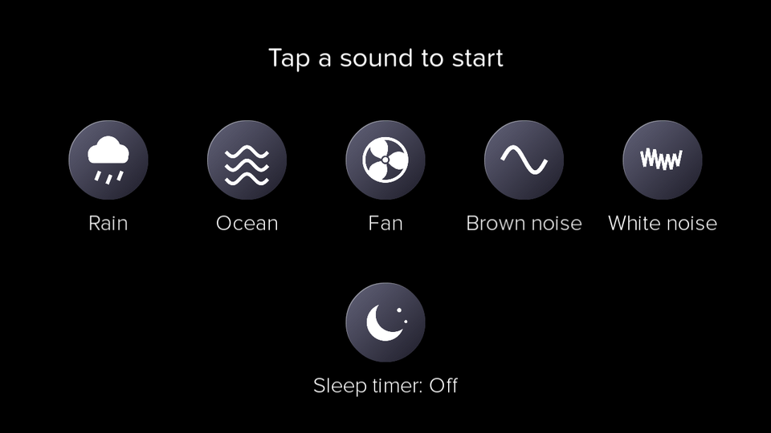
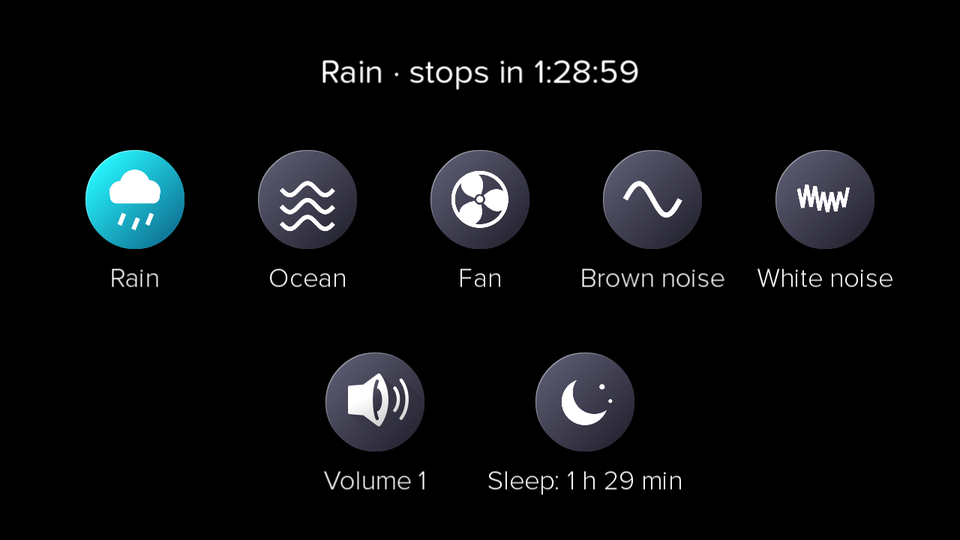
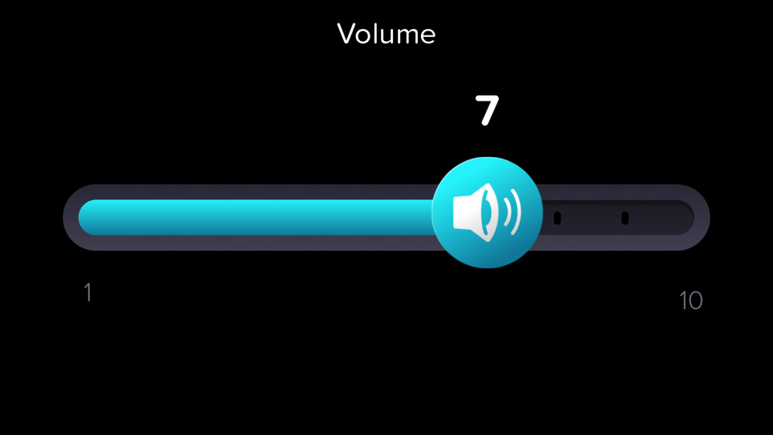
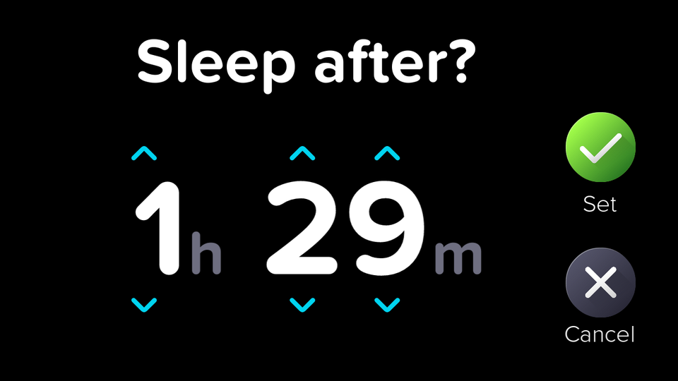

# Sound Machine

Relaxing sounds from Jibo for sleeping, focusing or relaxing: rain, ocean waves, a fan, brown noise and white noise. Set a sleep timer and Jibo gently fades the sound out when it ends.

## How to use it

1. Open **Sound Machine** from Jibo's main menu.
2. Tap a sound to start it. The button turns cyan while it plays.
3. Tap another sound to switch, or tap the playing sound again to stop it.
4. Tap the **speaker** button to change the volume. Drag or tap along the slider; it closes by itself after a few seconds, or tap above or below it.
5. Tap the **moon** button to set the sleep timer. Use the arrows to choose hours and minutes, just like setting a timer on Jibo, then tap **Set**. Set it to 0h 00m to turn it off.
6. Swipe down to leave Sound Machine. The sound stops when you leave.

## Sounds

- **Rain:** real rain falling in a city garden.
- **Ocean:** real waves rolling onto a beach.
- **Fan:** a real rotating fan.
- **Brown noise:** a deep, soft rumble.
- **White noise:** a bright, even hiss.

Each sound is a recording that loops without a gap. They fade in when they start so there is no sudden pop. When the sleep timer ends, the sound fades out over ten seconds. The volume control changes Jibo's own volume, the same as his volume setting.

## Requirements

5x1 3.1.7 or newer. Works offline; the sounds are included in the skill.

## Credits

All sounds are from [Freesound](https://freesound.org) under [CC0](https://creativecommons.org/publicdomain/zero/1.0/), trimmed into loops and levelled by `tools/make-sounds.py`.

- Rain: [Stereo city garden rain](https://freesound.org/s/705164/) by itinerantmonk108
- Ocean: [Ocean Waves.wav](https://freesound.org/s/531015/) by Noted451
- Fan: [Rotating fan loop](https://freesound.org/s/797668/) by HenKonen
- Brown noise: [Brown Noise (Medium)](https://freesound.org/s/365932/) by OldSlowVideogamer
- White noise: [White Noise -20dBFS 30 Second.wav](https://freesound.org/s/249313/) by JarredGibb
